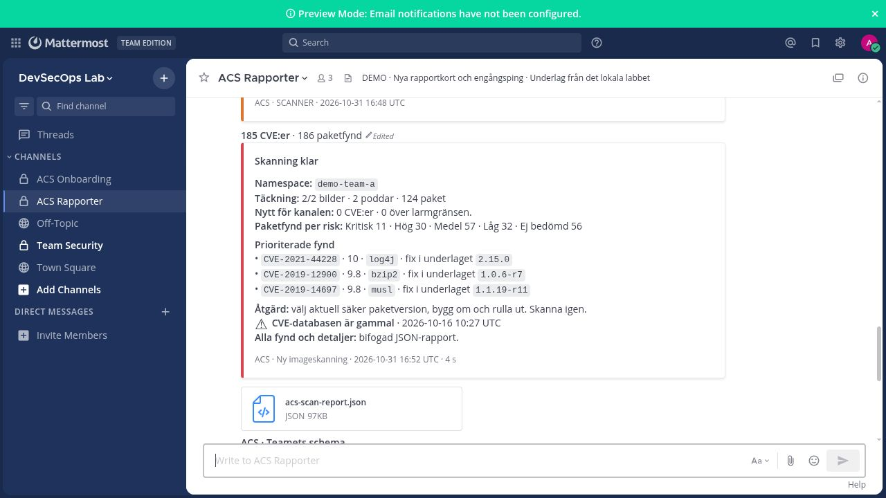
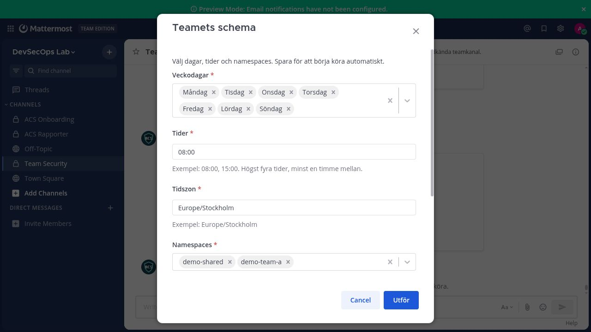
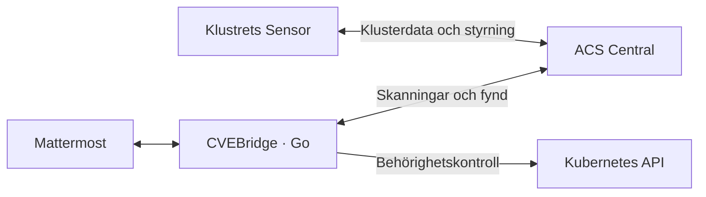

<h1 align="center">CVEBridge</h1>
<p align="center"><strong>Från CVE till åtgärd. Direkt i Mattermost.</strong></p>

<p align="center">
  <a href="https://github.com/SmidraClawd/cvebridge/actions/workflows/test.yml"></a>
  <a href="go.mod"></a>
  <a href="LICENSE"></a>
</p>

CVEBridge kopplar **ACS/StackRox** till **Mattermost** så att teamet kan arbeta
med containersårbarheter direkt i sin kanal. Starta en skanning, sök en CVE
eller planera återkommande rapporter. Få en kort sammanfattning med prioriterade
fynd, **Åtgärd** och en JSON-bilaga med alla detaljer.



## Det här kan teamet göra

| Uppgift | Skriv i Mattermost |
| --- | --- |
| Skanna images som används av aktiva workloads | `/cve scan team-a` |
| Undersök en specifik sårbarhet | `/cve CVE-2021-44228 team-a` |
| Välj rapportdagar, tider och namespaces | `/cve schedule` |
| Kontrollera CVE-databasens aktualitet | `/cve status` |

`/cve help` visar alla kommandon, även rapporter från befintliga skanningsresultat.
Teamet arbetar i en godkänd privat kanal. Ansvarig admin konfigurerar integrationen
en gång; den dagliga användningen sker direkt i Mattermost.

<details>
<summary><strong>Visa schemaformuläret</strong></summary>

Välj dagar, tider och namespaces. Spara, pausa, provkör ett sparat schema eller
visa körhistoriken i samma formulär.



</details>

<sub>Referensbilder från det tidigare lokala Mattermost-labbet. Go-versionen använder
samma rapport- och formulärprinciper.</sub>

## Så hänger det ihop



Sensorn skickar klusterdata till Central. Boten använder **Centrals API** för
skanningar och fynd, och klustrets **Kubernetes-API** för namespace-behörigheter.
Central kan finnas i samma kluster eller ett annat. Scheman och CVE-bevakning
sparas så att rapporter kan återkomma och upprepade kritiska larm kan begränsas.

## Bygg och utforska

```bash
git clone https://github.com/SmidraClawd/cvebridge.git
cd cvebridge
go test -race ./...
docker build -t cvebridge:dev .
```

Go 1.27.3 används i CI och Dockerfile. En ansluten installation behöver Mattermost,
ACS Central, godkända Kubernetes-behörigheter och beständig lagring.
Börja med [inställningsmallen](.env.example) och [utvecklarguiden](START_HAR.md).
Företagsvärden ligger i din lokala `.env`; imagen innehåller programkoden.

## Status

Skriven i **Go**, med SQLite för scheman och bevakning. En vanlig Deployment
med en replika och en intern Service som standard. Mattermost måste nå tjänsten.

**39 Go-testfunktioner**, race-kontroller, statisk analys och containerbygge ingår
i CI. Manuell skanning, CVE-sökning och sparade scheman har också provats mot ett
riktigt lokalt Mattermost- och ACS-labb. Installation i företagets OpenShift-miljö
behöver verifieras där.

[Arkitektur](docs/ARKITEKTUR.md) · [Åtkomstmodell](docs/ACCESS.md) · [Verifiering](docs/VERIFIERING.md)

## Bidra

Har du ett arbetsflöde som kan bli bättre? [Öppna ett issue](https://github.com/SmidraClawd/cvebridge/issues)
eller skicka en pull request. Om projektet hjälper ditt team får du gärna ge det
en stjärna eller dela det vidare.

[MIT-licens](LICENSE).
